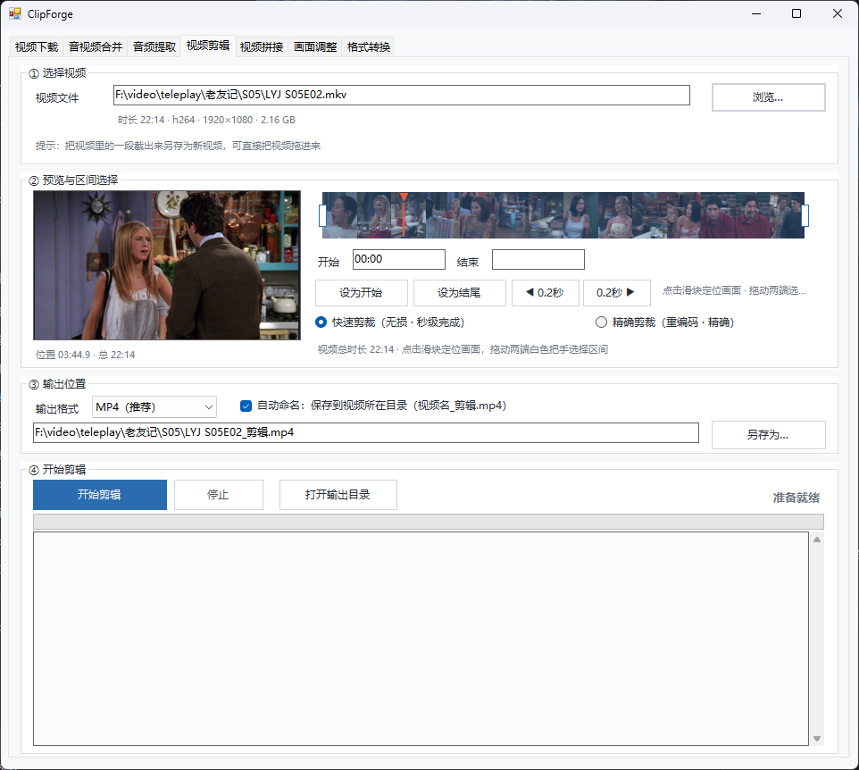

# ClipForge

[English](README.md)

一款基于 WinForms + ffmpeg 的 Windows 音视频处理工具箱。



## 功能特性

- 音视频合并（单个 / 批量）
- 音频提取
- 视频剪辑（可视化区间选择）
- 视频拼接
- 画面调整（旋转 / 裁剪 / 调色 / 缩放）
- 格式转换（视频 / 音频互转，支持导出 GIF）
- 视频下载（m3u8 / 直链）

## 项目结构

```text
.
├─ src/                  # C# 源码
│  ├─ ClipForge.cs
│  └─ Snapshot.cs
├─ lib/                  # 第三方工具（如 N_m3u8DL-CLI）
├─ docs/
│  └─ 使用说明.txt       # 详细中文使用说明
├─ dist/                 # 构建输出（gitignored）
├─ build.ps1             # 构建脚本
├─ README.md
└─ README.zh-CN.md
```

## 构建

环境要求：Windows + .NET Framework 4.x（`csc.exe`）。

```powershell
./build.ps1
```

输出：`dist/ClipForge.exe`（`lib/` 中的第三方工具会复制到 `dist/lib/`）。

## 依赖

- [ffmpeg / ffprobe](https://ffmpeg.org/)：核心处理组件（运行时自动检测，也可手动指定路径）
- [N_m3u8DL-CLI](https://github.com/nilaoda/N_m3u8DL-CLI)：可选，用于 m3u8 下载

## 使用

运行 `dist/ClipForge.exe`。详细操作说明请参阅 [docs/使用说明.txt](docs/使用说明.txt)。

## 运行时数据

程序在可执行文件所在目录生成以下文件（已在 `.gitignore` 中忽略）：

- `settings.ini`：保存 ffmpeg / N_m3u8DL 路径等设置
- `download_history.json`：下载记录（旧版 `download_history.txt` 会自动迁移）
- `crash.log`：异常日志（如有）
